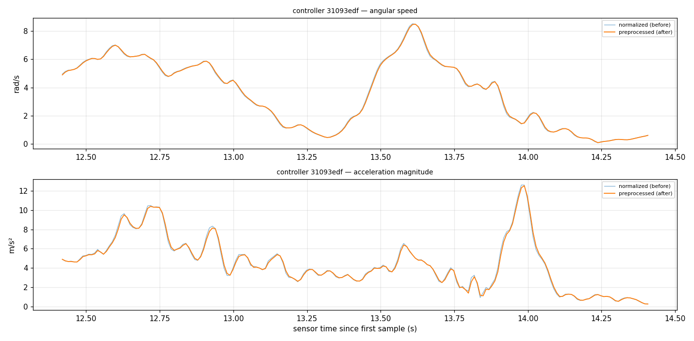

# Two-Phone Motion Badminton

**Turn two ordinary phones into motion-sensing badminton rackets for a desktop game.**

Each phone streams its gyroscope, accelerometer and orientation over the local
Wi-Fi network. A Godot desktop host pairs the phones by QR code, synchronizes
their clocks, calibrates them into one shared "racket" coordinate frame, and
detects swings early enough that the game can react in well under 50 ms. No
custom hardware, no accounts, no internet.

> [!IMPORTANT]
> **Project status: swing laboratory (milestone M2).** The controller path is
> built and physically measured: pairing, streaming, clock sync, reconnect,
> calibration, capture/replay and a first swing detector all work on real
> phones. **The badminton game itself is not built yet.** Gameplay is
> deliberately gated behind measured swing-detection accuracy. See the
> [roadmap](docs/roadmap.md).

| | |
| --- | --- |
| **Host** | Godot 4.7 (GDScript), desktop: macOS today, Windows and Linux targeted |
| **Controllers** | Native iOS (SwiftUI, Core Motion) and Android (Kotlin) apps |
| **Transport** | Unicast UDP on the LAN, custom big-endian binary protocol v1 |
| **Tooling** | Python and Ruby analysis tools with pytest suites |
| **License** | [MIT](LICENSE) |

---

## Contents

- [Why this exists](#why-this-exists)
- [How it works](#how-it-works)
- [Measured results so far](#measured-results-so-far)
- [Quick start](#quick-start)
- [Repository layout](#repository-layout)
- [Documentation](#documentation)
- [Roadmap](#roadmap)
- [Research](#research)
- [Contributing](#contributing)
- [Data and privacy](#data-and-privacy)
- [License](#license)

## Why this exists

Motion-controlled sports games usually need dedicated controllers. Almost
everyone already carries a phone with a good IMU in it. The open question
this project answers with measurements rather than assumptions is:

> Can a pair of stock phones, over home Wi-Fi, feel as immediate as a real
> controller when swung like a badminton racket?

The design goals come from the [product requirements](Two-Phone%20Motion%20Badminton%20PRD.md):

| Measure | Target |
| --- | --- |
| Swing-to-screen latency, median | < 50 ms |
| Swing-to-screen latency, worst 1% | < 80 ms |
| Dropped or late motion packets | < 1% |
| Real swings detected | ≥ 95% |
| False swings | < 1 per 10 minutes |
| From launch to live rally | < 1 minute |

Non-goals for the first release: 1:1 hand or racket tracking, online play,
custom hardware, app-store release and console support. The game reads swing
*timing, power, type and angle* and moves each player into position
automatically.

## How it works

```text
┌──────────────────────┐                     ┌──────────────────────┐
│ iPhone controller    │                     │ Android controller   │
│ Core Motion, 100 Hz  │                     │ Sensor API, 250 Hz   │
│ QR join, calibration │                     │ QR join, calibration │
└──────────┬───────────┘                     └───────────┬──────────┘
           │   one UDP datagram per sample, no batching  │
           └──────────────────────┬──────────────────────┘
                                  ▼  5 GHz Wi-Fi LAN
                 ┌────────────────────────────────────┐
                 │ Godot desktop host                 │
                 │  pairing + session manager         │
                 │  clock synchronizer (PING/PONG)    │
                 │  motion ingest, stale-drop, logs   │
                 │  calibration → common racket frame │
                 │  preprocessing → early-swing detect│
                 │  (next) fixed-step game simulation │
                 └────────────────────────────────────┘
```

1. **Pair.** The host shows a QR code containing its LAN address, a random
   session ID and a 128-bit, 120-second pairing secret. The phone scans it and
   sends `HELLO`; the host checks the secret in constant time and replies
   `WELCOME` with a Player 1 / Player 2 assignment.
2. **Synchronize clocks.** Four-timestamp `PING`/`PONG` exchanges estimate
   round-trip time and the phone-to-host monotonic clock offset, so every
   sample's *sensor* time can be expressed in host time.
3. **Calibrate.** The player holds the phone still in a neutral racket grip,
   picks a hand, then makes one controlled slow swing. This fixes the neutral
   attitude, sensor bias and handedness. The host maps each phone's native axes into one
   [common racket frame](docs/racket-coordinate-system.md), so detection code
   never branches on platform or hand.
4. **Stream.** Every sensor sample becomes one 80-byte `MOTION` datagram,
   sent immediately. Lost packets are never retransmitted; stale samples are
   dropped by sensor age rather than delaying the game.
5. **Detect.** A causal low-pass filter (2.6–4.6 ms of delay) feeds the
   `early_rise` detector, which triggers on the first sharp rise in racket
   angular speed, typically ~90 ms *before* the swing's peak.
6. **Record everything.** Raw datagrams, clock estimates, detector events and
   frame timings go to JSONL logs, and labeled captures replay through the
   exact live pipeline with identical output.

Details: [architecture overview](docs/architecture.md) ·
[protocol v1](protocol/spec.md) · [ADRs](docs/adr/README.md).

## Measured results so far

All numbers below are physical measurements on real devices unless marked
otherwise. Full provenance lives in the [research notes](docs/research.md) and
`docs/evidence/`.

| Question | Result | Evidence |
| --- | --- | --- |
| Is phone-to-screen latency good enough? | **Yes.** Sensor sample → host render: median 30.1 ms, p99 54.1 ms (41 triggers, Galaxy M14). With a conservative display allowance: median ≤ 47.6 ms, p99 ≤ 71.6 ms. | [Gate A decision](docs/test-plans/gate-a-decision.md) |
| Can both phones stream reliably at once? | **Yes, with AWDL off.** iPhone 100 Hz and Galaxy 249 Hz; loss + late 0.12% / 0.17%; sample-age p95 ≈ 20 ms. | [M1 soak report](docs/test-plans/m1-soak-report.md) |
| What broke reliability? | macOS **AWDL** (AirDrop/Continuity) adds ~100 ms receive stalls every 0.52 s on a Wi-Fi Mac host, making ~23% of samples late. The host now detects and warns about it. | [Soak report](docs/test-plans/m1-soak-report.md) |
| How much latency does filtering cost? | 2.6 ms at 100 Hz, 4.6 ms at 250 Hz (one-pole low-pass, 25 Hz cutoff). | [Preprocessing](docs/motion-preprocessing.md) |
| Does the swing detector work? | **Promising, not yet accepted.** iPhone tune split: recall 95.6%, precision 96.6%, 0.51 false triggers / 10 min, median 90 ms lead before peak. Held-out and second-phone evaluation pending. | [Tune report](docs/evidence/TMB-033-iphone-tune-v1.md) |

> These are engineering results from one operator, one room and two phones.
> They are not claims about every device or network.



## Quick start

The full walkthrough, including troubleshooting, is in
[Getting started](docs/getting-started.md). Exact tool versions are pinned in
the [development guide](docs/development.md).

**Prerequisites:** Godot 4.7.2 (standard build), Python 3 with pytest; for the
phone apps, Xcode 26.4 + [XcodeGen](https://github.com/yonaskolb/XcodeGen)
and/or Android Studio with JDK 17.

```sh
git clone https://github.com/mayur19/motion-control.git
cd motion-control

# 1. Host: import, smoke-test, then run it
godot --headless --path apps/host-godot --import
godot --headless --path apps/host-godot -- --smoke-test     # prints TMB-004_HOST_SMOKE_OK
godot --path apps/host-godot

# 2. iOS controller (simulator build + tests)
cd apps/controller-ios && xcodegen generate
xcodebuild -project MotionControllerIOS.xcodeproj -scheme MotionControllerIOS \
  -sdk iphonesimulator -destination 'platform=iOS Simulator,name=iPhone 17' build test
cd ../..

# 3. Android controller (unit tests + debug APK)
cd apps/controller-android
./gradlew testDebugUnitTest assembleDebug
adb install -r app/build/outputs/apk/debug/app-debug.apk
cd ../..

# 4. Analysis tools
python3 -m pytest -q tools/
```

Then put the computer and phones on the **same 5 GHz Wi-Fi network** (no guest
isolation), open the controller app, scan the QR code on the host, and do the
slow calibration swing. On a Mac host, turn off AirDrop/Handoff (or run
`sudo ifconfig awdl0 down`) for clean latency.

> [!WARNING]
> Use a wrist strap and clear the space around you before swinging a phone.
> Swings never need full force; the detector rewards timing.

### Useful host options

| Option / key | Effect |
| --- | --- |
| `--reconnect-window-s=N` | Seat reservation after a disconnect (5–60 s, default 30) |
| `--session-log-max-mb=N` | Size cap for the JSONL session log |
| `--latency-test`, **F4** | Full-screen flash on raw gyro threshold, for 240 fps camera tests |
| `--log-normalized-motion`, **F5** | Log raw vs calibrated samples; F5 shows the live plot |
| **F6** | Labeled capture panel (record takes for the dataset) |

Session logs are written to Godot's user-data folder
(`~/Library/Application Support/Godot/app_userdata/Motion Badminton Host/logs/`
on macOS). Close the host window normally so the last log line is flushed.

## Repository layout

```text
.
├── apps/
│   ├── host-godot/           Godot host: network/, session/, motion/, detection/,
│   │                         capture/, replay/, latency/, logging/, ui/, tests/
│   ├── controller-ios/       SwiftUI + Core Motion controller (XcodeGen project.yml)
│   └── controller-android/   Kotlin controller (AGP 9 built-in Kotlin)
├── protocol/
│   ├── spec.md               Binary protocol v1 (frozen)
│   ├── golden-vectors/       Cross-language encode/decode fixtures
│   └── racket-coordinate-fixtures.json
├── tools/                    Analysis CLIs (soak, latency frames, dataset, detector
│                             evaluation, plots) + pytest suites, packet generator
├── docs/                     Guides, ADRs, test plans, evidence, research
├── implementation-tickets/   62 ordered tickets (TMB-001…062) with implementation logs
├── Two-Phone Motion Badminton PRD.md
└── Two-Phone Motion Badminton Architecture and Delivery Plan.md
```

## Documentation

Start at the **[documentation index](docs/README.md)**. Highlights:

| Topic | Document |
| --- | --- |
| Build, run and pair | [Getting started](docs/getting-started.md), [Development environment](docs/development.md) |
| System design | [Architecture overview](docs/architecture.md), [Delivery plan](Two-Phone%20Motion%20Badminton%20Architecture%20and%20Delivery%20Plan.md), [ADRs](docs/adr/README.md) |
| Wire format | [Protocol v1](protocol/spec.md), [Golden vectors](protocol/golden-vectors/README.md), [Pairing](docs/pairing.md) |
| Networking | [Clock synchronization](docs/clock-synchronization.md), [Heartbeat and reconnect](docs/reconnect.md), [Log schema](docs/log-schema.md) |
| Motion pipeline | [Racket coordinate system](docs/racket-coordinate-system.md), [Preprocessing](docs/motion-preprocessing.md), [Swing detection](docs/swing-detection.md) |
| Data and evaluation | [Capture format](docs/capture-format.md), [Detector evaluation](docs/detector-evaluation.md), [Dataset capture plan](docs/test-plans/tmb-030-dataset-capture-plan.md) |
| Planning | [Roadmap](docs/roadmap.md), [Ticket backlog](implementation-tickets/README.md), [PRD](Two-Phone%20Motion%20Badminton%20PRD.md) |
| Findings | [Research notes](docs/research.md), [External dataset evaluation](docs/external-dataset-evaluation.md) |

## Roadmap

Delivery runs through milestones separated by **evidence gates**: a missed
gate leads to a measured design decision, not automatic continuation.

| Phase | Goal | Status |
| --- | --- | --- |
| M0 Foundation | Toolchain, app shells, protocol v1, golden vectors | ✅ Done |
| M1 Instrumented slice | Both phones stream, pair, sync clocks, reconnect | ✅ Done (Ethernet soak not possible on test host) |
| Gate A Phone feasibility | Measured swing-to-screen latency | ✅ **GO** (2026-11-06) |
| M2 Swing laboratory | Calibration, capture/replay, dataset, detector, shot intent | 🔄 **In progress** |
| M2 gate (TMB-035) | Detector accuracy on held-out data, both phones | ⏳ Next |
| M3 One-player rally | Court, shuttle, auto-positioning, AI opponent, scoring | ⏳ Blocked on M2 gate |
| M4 Two-player match | Four shot outcomes, safety interlocks, resilience | ⏳ |
| Gate B Game feel | Structured playtest: do people want a rematch? | ⏳ |
| M5 Desktop release | Windows/macOS/Linux builds, CI, setup guide | ⏳ |
| Gate C Expansion | Browser (WebRTC) vs TV as the next host | ⏳ |

The detailed version, with near-term tasks, open issues and longer-term
ideas, is in **[docs/roadmap.md](docs/roadmap.md)**.

## Research

The project treats every design question as an experiment with recorded
evidence. The [research notes](docs/research.md) collect what has been
learned so far, including:

- the latency budget and how it was measured with a 240 fps camera;
- the macOS AWDL discovery and its effect on Wi-Fi input;
- the clock-synchronization estimator and observed drift;
- iOS vs Android sensor behaviour (rate, filtering, frames);
- detector design, tuning method, count-based metrics and their limits;
- dataset methodology (session-level tune/held-out split, decided before recording);
- an assessment of public badminton IMU datasets and why their thresholds do
  not transfer to a phone used as a racket;
- open research questions (backswing vs forward swing, cross-device transfer,
  shot-type intent).

## Contributing

Contributions, issues and measurements from other phones are welcome. Please
read **[CONTRIBUTING.md](CONTRIBUTING.md)** first. The short version:

- write the failing test first; every host test prints `TMB-…_OK` and exits 0;
- protocol changes must update `protocol/spec.md` and pass the golden vectors
  in Swift, Kotlin and GDScript;
- report evidence honestly: never present an estimate or synthetic result as a
  physical measurement;
- use conventional commits (`feat:`, `fix:`, `docs:` …).

## Data and privacy

- No accounts, no cloud, no analytics. Logs never contain audio, video or
  personal data. Controllers identify themselves with a random installation
  ID, not a hardware identifier.
- The QR pairing secret is short-lived and session-scoped. Do not post host
  screenshots or `--print-session` output publicly while a session is live.
- **Third-party datasets are not redistributed.** The BadminSense `BADS_CLL`
  dataset (CC BY-NC-ND) was evaluated locally for research only; neither the
  data nor anything derived from it is in this repository, and
  `tools/test_no_external_data.py` enforces that.

## License

[MIT](LICENSE). The vendored QR generator in
`apps/host-godot/addons/greaby_qrcode` is MIT-licensed by its author; see the
license file beside it. External datasets referenced in `docs/` keep their own
licenses.
